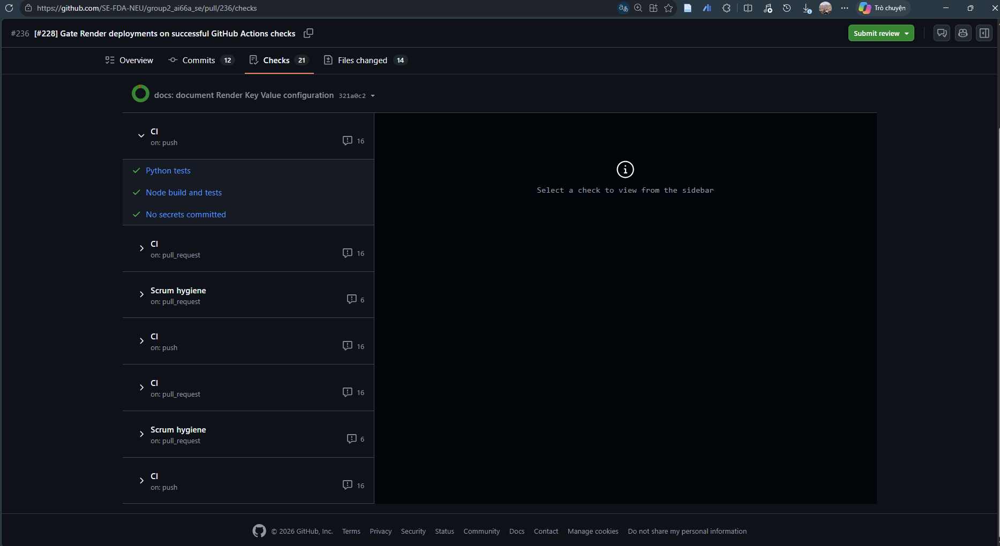
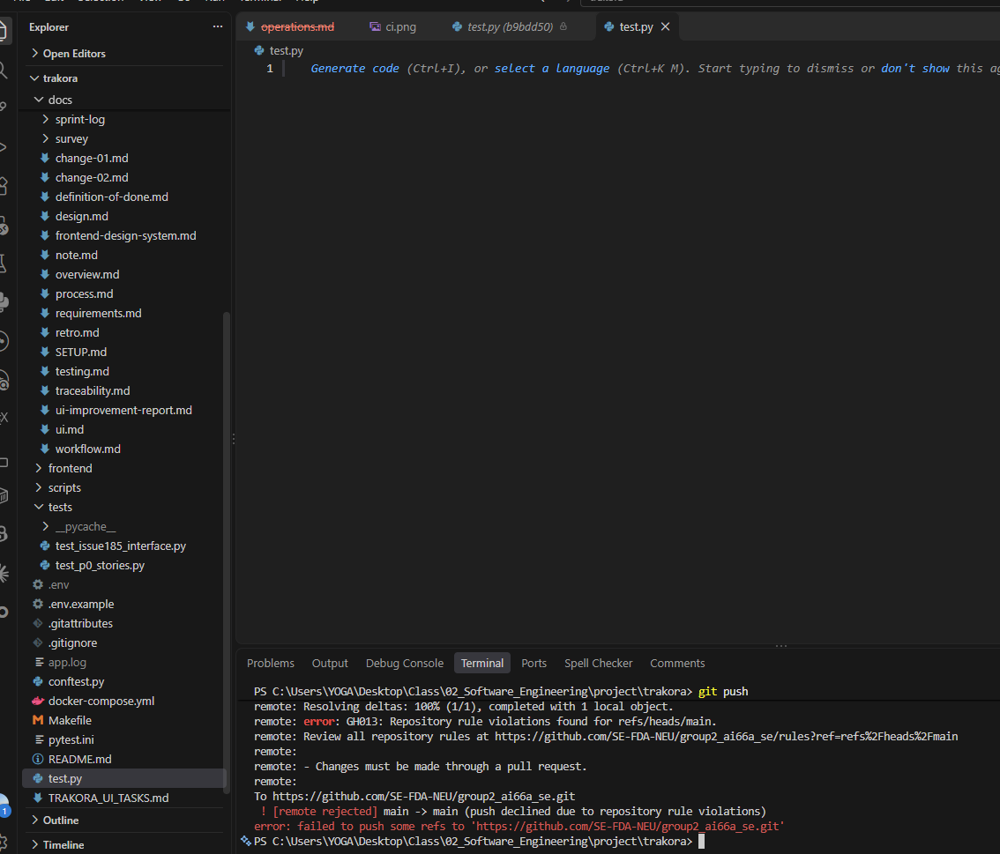

# Milestone 5 — Operations Manual (Trakora)

```text
Running app:    https://group2-ai66a-se-1.onrender.com
Team:           Team 02 — Automated E-commerce Price Tracker
Members:        Nguyen Trong Dai (11247268), Mai Huy Dang (11247269),
                Pham Huu Gia An (11247254), Mai Tuan Manh (11247318),
                Le Ba Phong (11247339)
Scrum Master:   @Dai-Nguyen1506  (Sprint 5)

Repository:     https://github.com/SE-FDA-NEU/group2_ai66a_se
Release v1.0:   https://github.com/SE-FDA-NEU/group2_ai66a_se/releases/tag/v1.0
Latest green CI run on main: https://github.com/SE-FDA-NEU/group2_ai66a_se/pull/236/checks
Test accounts:  see the first screen of README.md
```

---

## 1. How to run and release

- **Public URL:** https://group2-ai66a-se-1.onrender.com
- **Platform:** **Render** (Web Service & Static Site), **Supabase PostgreSQL** (`Session pooler` over TLS), and **Render Key Value** (Redis 7).
- **Release Flow (`merge → CI green → deploy`):**
  1. Changes are pushed to a feature branch (`<issue-id>-<short-description>`) and submitted via Pull Request to `main`.
  2. Branch protection requires 1 peer approval and all 3 jobs in `.github/workflows/ci.yml` (`Python tests`, `Node build and tests`, `No secrets committed`) to pass.
  3. Render uses **Auto-Deploy: After CI Checks Pass** (`#228`). Once merged into `main` with green CI, Render builds and deploys the image.
  4. On startup, `backend/entrypoint.sh` verifies DB readiness (`wait_db.py`), runs `alembic upgrade head`, syncs the admin user, and starts `uvicorn main:app --host 0.0.0.0 --port $PORT`.
- **How to Roll Back:**
  - **Platform Rollback:** In **Render Dashboard → Service → Deploys**, select the last known-good deploy (`v1.0` commit) and click **Rollback** to restore the previous image in ~60s.
  - **Git Revert:** Merge a `git revert <bad-commit-sha>` PR into `main` so CI and Render redeploy the clean state (run `alembic downgrade -1` first if a migration changed).

---

## 2. The CI pipeline

The workflow [`.github/workflows/ci.yml`](../.github/workflows/ci.yml) runs on every push and pull request targeting `main` or `develop`. A full run takes **~1 minute 30 seconds** with pip/npm caching.

- **Latest green CI run on `main`:** [PR #236 CI Checks (`321a0c2`)](https://github.com/SE-FDA-NEU/group2_ai66a_se/pull/236/checks) · [Workflow runs on `main`](https://github.com/SE-FDA-NEU/group2_ai66a_se/actions/workflows/ci.yml?query=branch%3Amain+is%3Asuccess)

| Job | Step | What it checks |
| :--- | :--- | :--- |
| **`python`** (`Python tests`) | `setup-python@v5` & `setup-node@v4` | Sets up Python 3.11 (pip cache) and Node.js 22 (npm cache) for backend and cross-stack interface tests. |
| **`python`** (`Python tests`) | `Install frontend dependencies` | Runs `npm ci` in `frontend/` so Python-invoked Vitest interface tests run offline. |
| **`python`** (`Python tests`) | `Install dependencies` | Upgrades `pip` and installs `backend/requirements.txt`, `pytest`, `pytest-cov`, and `ruff`. |
| **`python`** (`Python tests`) | `Lint` | Runs `ruff check . --output-format=github` to catch Python syntax and lint issues. |
| **`python`** (`Python tests`) | `Test` & `Publish test summary` | Runs `pytest -v --cov=backend --cov-report=term-missing --junitxml=junit.xml` across unit, integration, and P0 story suites, then publishes counts to `$GITHUB_STEP_SUMMARY`. |
| **`node`** (`Node build and tests`) | `Install dependencies` | Runs deterministic `npm ci` in `frontend/` from `package-lock.json`. |
| **`node`** (`Node build and tests`) | `Lint` | Runs `npm run lint --if-present` for TypeScript/React lint rules. |
| **`node`** (`Node build and tests`) | `Test` | Runs `npm test --if-present` (Vitest unit and component tests). |
| **`node`** (`Node build and tests`) | `Build` | Runs `npm run build --if-present` (`tsc && vite build`) to verify static types and production bundling. |
| **`secrets`** (`No secrets committed`) | `Scan for obvious credentials` | Uses `git grep -nIE` to block AWS keys (`AKIA...`), GitHub tokens (`ghp_...`), private keys, and hardcoded `password = "..."` strings. |
| **`secrets`** (`No secrets committed`) | `No .env or database dumps` | Fails if `git ls-files` contains `.env`, `.sql`, `.sqlite3`, or `.dump` files. |

### CI & Branch Protection Evidence





---

## 3. Monitoring

- **What the app logs & where to read it:** `app_logger` (`backend/app/core/logger.py`) writes structured entries (`timestamp [LEVEL] file:line - message`) to `stdout` and `app.log`. In production, logs are read in **Render Dashboard → Service → Logs**. It records startup checks, Alembic migrations, background monitor/email task lifecycle, database/Redis connection errors, and unhandled exception tracebacks (`backend/app/core/exceptions.py`).
- **What the app never logs:** Plaintext passwords, bcrypt hashes, JWT bearer tokens, 6-digit OTP codes, `SMTP_PASSWORD`, `RAPIDAPI_KEY`, and raw `DATABASE_URL` or `REDIS_URL` strings (`wait_db.py` and `redis.py` suppress connection URLs on error).
- **What `/health` checks:** `GET /health` calls `dev_service.check_health(db, redis)` to run `SELECT 1` on PostgreSQL and `PING` on Redis concurrently. It returns **HTTP 200** when both succeed and **HTTP 503** (`DATABASE_ERROR` / `REDIS_ERROR`) when either fails.
- **Two numbers we watch:**
  1. **Error rate (HTTP 5xx %):** Target `< 1%`. We notice issues when Render's `/health` check receives HTTP 503 (triggering an unhealthy-service email alert) or when `[ERROR]` logs spike in Render Logs.
  2. **Response time (p95 latency):** Target `< 500 ms` for DB/cache reads and `< 3,000 ms` for RapidAPI lookups. We notice degradation via Render's **Metrics** latency charts and slow-request warnings in Render Logs.

---

## 4. Known risks and technical debt

| Item | Layer | What could happen | Plan |
| :--- | :--- | :--- | :--- |
| **External RapidAPI Amazon dependency & quota** | `infrastructure` | If RapidAPI hits free-tier rate limits or downtime, adding uncached URLs returns `503 MARKETPLACE_UNAVAILABLE`. | Accepted — cached products and seeded demo data still work via BR3, and the adapter isolates RapidAPI for future replacement. |
| **Shopee & TikTok Shop deferred to Amazon adapter** | `code` | Pasting Shopee/TikTok URLs returns `400 AMAZON_ONLY` because anti-bot walls block public scraping without partner keys. | Accepted — documented in BR9 (`docs/change-01.md`) to ensure reliable REST data during course evaluation. |
| **Lint steps use `continue-on-error: true` in `ci.yml`** | `tests` | Style warnings in `ruff` or `npm run lint` do not block merges if tests and builds pass. | Accepted — `pytest`, `tsc`, Vite build, and secret scans strictly gate merges while avoiding non-functional lint blocks. |
| **In-process background loops (`asyncio.create_task`)** | `code` | `price_monitor_service` and email delivery run inside FastAPI's lifespan; multiple web workers would duplicate polling. | `#225` — run a single Uvicorn instance on Render for v1.0; split into a separate worker if scaling horizontally. |
| **Supabase Session Pooler connection cap (5 + 5 overflow)** | `data` | Bursts exceeding 10 concurrent DB queries per instance could queue or time out (`#226`). | Accepted — `pool_size=5, max_overflow=5` in `database.py` fits free-tier Supabase session limits for classroom traffic. |
| **Legacy Sprint 1 notes in `docs/overview.md`** | `docs` | Readers opening `docs/overview.md` before `README.md` may see early skeleton descriptions. | `#228` — maintain `README.md`, `docs/SETUP.md`, `docs/design.md`, and `docs/operations.md` as the authoritative v1.0 docs. |

---

## 5. Maintenance plan

| Area | What to do | Owner | How often |
| :--- | :--- | :--- | :--- |
| **Bugs** | Triage bug issues, write a failing regression test in `tests/`, and merge a reviewed fix PR into `main`. | `@CaMapCon26` | Within 48 hours of report / weekly |
| **Dependency updates** | Check `pip list --outdated` and `npm audit`, update patch/minor packages on a branch, and verify green CI. | `@huydang2006` | Bi-weekly (start of each sprint) |
| **Backups of the data** | Verify Supabase daily snapshots and export a manual `pg_dump` backup before running new Alembic migrations. | `@happyhusky3303` | Weekly & before every migration |
| **Monitoring** | Check `/health`, inspect Render Logs for `[ERROR]` spikes (`DATABASE_ERROR`, `REDIS_ERROR`), and check RapidAPI quota. | `@maimanhbel` | Daily during grading / demo weeks |
| **Keeping the docs true** | Update `README.md`, `docs/SETUP.md`, `docs/design.md`, and `docs/operations.md` in the same PR as any route, env, or rule change. | `@Dai-Nguyen1506` | On every PR changing routes, env vars, or rules |

---

## 6. Lessons learned

1. **Marketplace anti-bot walls vs. deterministic APIs (Sprint 2):**
   - **What happened:** Direct scraping of Shopee and TikTok Shop failed due to CAPTCHAs and anti-bot obfuscation, risking a blocked walking skeleton.
   - **What we changed:** We pivoted to an adapter architecture backed by the RapidAPI Real-Time Amazon Data API (`rapidapi_client.py`) and recorded the decision in `docs/change-01.md` and `docs/design.md`.
   - **What we would do differently next time:** Run a technical spike on external data sources in Week 1 before locking business rules to a vendor.

2. **UI integration regressions on mobile and table layouts (Sprint 3):**
   - **What happened:** Components worked in isolation, but real product data caused watchlist column misalignment (`#164`) and mobile overflow on 375px screens (`#181`).
   - **What we changed:** We rebuilt the watchlist with a shared responsive CSS grid, fixed mobile chart containers, and added a mandatory PR UI checklist (375px mobile, loading, empty, and error states).
   - **What we would do differently next time:** Test every UI component with long real-world strings and a 375px viewport before opening a PR.

3. **Test suite coupling to external services and local tools (Sprint 4):**
   - **What happened:** Early tests depended on live DB/Redis instances or unguarded `npx` calls, causing flaky failures on clean machines and CI runners.
   - **What we changed:** We created deterministic in-memory fakes in `conftest.py` and an `autouse` offline guard (`notification_tests_are_offline`) that blocks real socket, HTTP, or SMTP connections during tests.
   - **What we would do differently next time:** Build the dependency-injection fake layer alongside the Sprint 2 walking skeleton so all tests run offline in seconds from day one.
