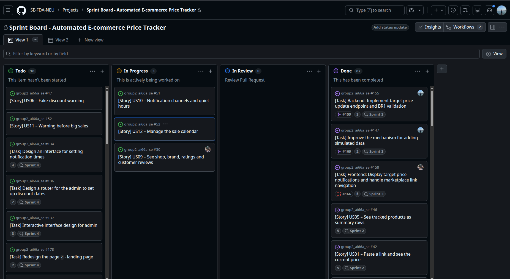
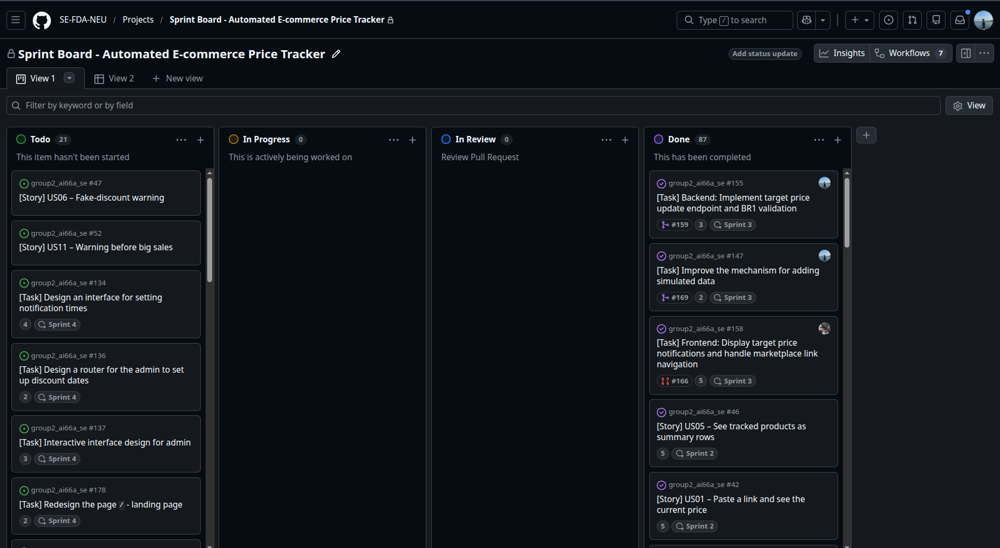
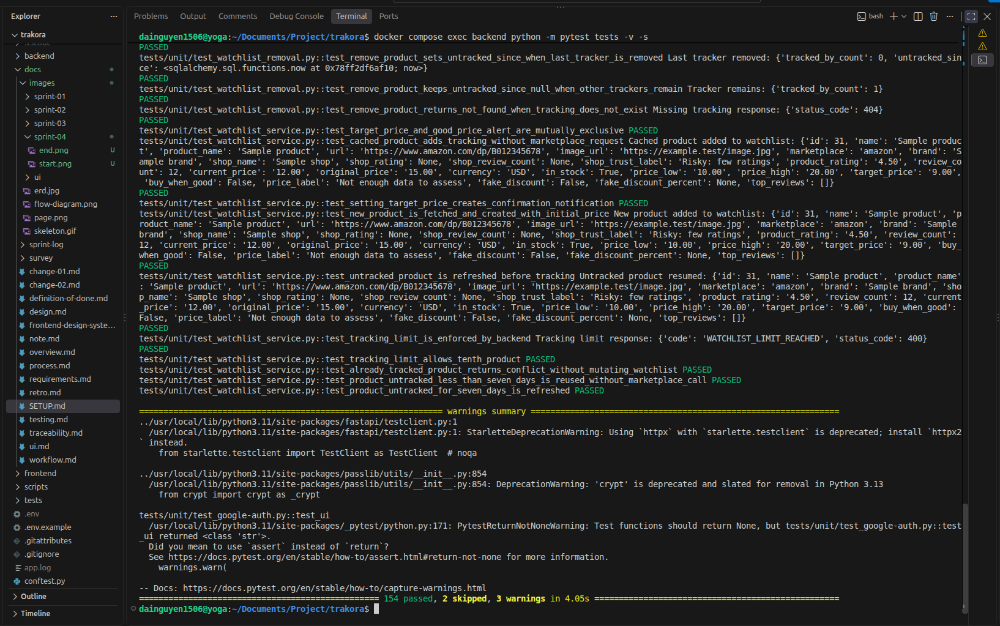

# Milestone 4 - Automated Testing Report

```
Team:           Team 02 - Automated E-commerce Price Tracker
Topic:          A3
Members:        Nguyen Trong Dai (11247268), Mai Huy Dang (11247269),
                Pham Huu Gia An (11247254), Mai Tuan Manh (11247318),
                Le Ba Phong (11247339)
Product Owner:  @Dai-nguyen1506
Scrum Master:   @huydang2006  (Sprint 4)

Repository:     https://github.com/SE-FDA-NEU/group2_ai66a_se.git;
Project board:  https://github.com/orgs/SE-FDA-NEU/projects/19/views/1;
Setup guide:    https://github.com/SE-FDA-NEU/group2_ai66a_se/blob/main/docs/SETUP.md
Pull Request:   https://github.com/SE-FDA-NEU/group2_ai66a_se/pull/210
Merge commit:   ...

Submitted by:   Nguyen Trong Dai
```







---

## 1. What we test, and why

| Layer | Test | Why |
|---|---|---|
| `backend/app/services/` (services) | Unit tests with in-memory fake database sessions, mock CRUD repositories, and mock external clients | All core business rules reside here (10-product limit **BR8**, 7-day grace period **BR15**, target-price validation **BR1/BR2**, price labels **BR5/BR6/BR7**, OTP limits **BR13**). This is where logic errors have the highest cost, risking bad alerts, data corruption, or unauthorized operations. |
| `backend/app/crud/` (repository) | Unit tests using SQLite in-memory and mock SQL expressions | Validates query construction, SQL join logic across watchlist tables, and database constraints without requiring a live PostgreSQL instance. |
| `backend/app/api/v1/endpoints/` (routes) | Integration tests using FastAPI `AsyncClient` with `ASGITransport` | Verifies HTTP status codes (200, 201, 400, 401, 404, 409, 422), response JSON schemas, header handling, and dependency injection overrides without spinning up an HTTP server. |
| `frontend/src/` (interface) | Automated Vitest test suites (run independently in frontend directory) | UI presentation and layout tests are decoupled from backend CI runs to keep regression testing sub-second and resilient across clean environments. |

### Risk Assessment & Testing Focus

The testing effort is concentrated heavily on the **Service Layer** and **Authentication Endpoints**:
1. **Watchlist & Price Tracking Integrity:** Overfilling user watchlists beyond capacity (BR8) or miscalculating price comparison thresholds (BR6, BR7) directly breaks user trust and violates system limits.
2. **Security & Authentication Boundary Rules:** OTP rate limiting (maximum 5 attempts) and expiration boundaries (300 seconds) are critical security frontiers. Any regression could allow brute-force attacks or lock legitimate users out of their accounts.
3. **Grace Period & Data Retention:** Ensuring the 7-day untracked product reuse/refresh boundary (BR15) functions accurately prevents unnecessary third-party API costs while avoiding stale price caches.

---

## 2. Test cases for every P0 story

Every P0 story is guarded by at least three test cases: normal success cases, error cases where business rules reject invalid input, and boundary cases checking both sides of all numerical limits.

### US01 — Add a product to the watchlist (BR8, BR15)

| ID | Story | Input | Expected result | Kind |
|---|---|---|---|---|
| **US01-TC-001** | US01 Add a product | Valid Amazon URL for unstored product; watchlist has capacity (count = 2) | 201, product fetched from marketplace, initial price saved, tracking created | Normal |
| **US01-TC-002** | US01 Add a product | Valid Amazon URL that the user already tracks in their watchlist | 409, `PRODUCT_ALREADY_TRACKED`, watchlist unmutated, rollback executed | Error |
| **US01-TC-003** | US01 Add a product | Valid Amazon URL when user tracks exactly 9 products (boundary below limit) | 201, tenth product is accepted and saved, commit executed | Boundary, on limit |
| **US01-TC-004** | US01 Add a product | Valid Amazon URL when user tracks exactly 10 products (boundary above limit) | 400, `WATCHLIST_LIMIT_REACHED`, addition refused, rollback executed | Boundary, just above |
| **US01-TC-005** | US01 Add a product | Valid URL for product untracked for 6 days (< 7-day grace period) | 201, product data reused without marketplace API call, untracked timestamp cleared | Boundary, just below |
| **US01-TC-006** | US01 Add a product | Valid URL for product untracked for exactly 7 days (>= 7-day grace period) | 201, marketplace refreshed before tracking resumes, new price recorded | Boundary, on limit |

### US02 — Set a target price and get notified (BR1, BR2, BR4)

| ID | Story | Input | Expected result | Kind |
|---|---|---|---|---|
| **US02-TC-001** | US02 Set target price | Product current price $100.00; target price $90.00 (< current price) | 200, target price saved, `target_price_set` confirmation notification created | Normal |
| **US02-TC-002** | US02 Set target price | Product current price $100.00; target price $100.00 (== current price) | 400, `INVALID_TARGET_PRICE`, rejected under BR1 (must be lower than current price) | Boundary, on limit |
| **US02-TC-003** | US02 Set target price | Product current price $100.00; target price $101.00 (> current price) | 400, `INVALID_TARGET_PRICE`, rejected under BR1 (target cannot exceed current price) | Boundary, just above |
| **US02-TC-004** | US02 Set target price | Target price $0.00 or -$10.00 (non-positive target) | 422 / ValidationError, target price rejected by schema validation | Error |
| **US02-TC-005** | US02 Set target price | Target price $80.00 for a product the user does not track | 404, `TRACKING_NOT_FOUND`, rejected with rollback | Error |

### US03 — See full price history & gap detection (BR15)

| ID | Story | Input | Expected result | Kind |
|---|---|---|---|---|
| **US03-TC-001** | US03 Full price history | Product ID with recorded price history points; user tracks product | 200, ordered price data points returned along with tracked days | Normal |
| **US03-TC-002** | US03 Full price history | Product ID not tracked by current user | 404, `TRACKING_NOT_FOUND`, history request rejected | Error |
| **US03-TC-003** | US03 Full price history | Two recordings separated by exactly 30 minutes (threshold = 30 min) | 200, `is_gap = False`, period treated as continuous | Boundary, on limit |
| **US03-TC-004** | US03 Full price history | Two recordings separated by 31 minutes (threshold = 30 min) | 200, `is_gap = True`, period marked as gap | Boundary, just above |
| **US03-TC-005** | US03 Full price history | Query parameter `days=0` (all-time lifetime history) | 200, returns full historical points without date cutoff (`since=None`) | Boundary, all-time |

### US04 — Register and sign in with Google or Email (BR13, BR14)

| ID | Story | Input | Expected result | Kind |
|---|---|---|---|---|
| **US04-TC-001** | US04 Auth & OTP | Valid email, verified OTP token, nickname, and password registration | 201 user registered; subsequent login returns valid JWT access token | Normal |
| **US04-TC-002** | US04 Auth & OTP | Valid Google OAuth id_token for new user | 200, user created with `auth_provider='google'` and access token returned | Normal |
| **US04-TC-003** | US04 Auth & OTP | Valid email, verified OTP token, and new password | 200, password updated and user can log in with new credentials | Normal |
| **US04-TC-004** | US04 Auth & OTP | Submit invalid OTP 5 times, then submit 6th attempt | Attempts 1–5 return `OTP_INVALID`; attempt 6 returns `OTP_LIMIT_EXCEEDED` | Boundary, attempt limit |
| **US04-TC-005** | US04 Auth & OTP | Submit correct OTP 299 seconds after issuance (TTL = 300s) | 200, OTP verified successfully and verification token returned | Boundary, just below |
| **US04-TC-006** | US04 Auth & OTP | Submit correct OTP 300 seconds after issuance (TTL = 300s) | 400, rejected with `OTP_EXPIRED` | Boundary, on limit |

### US05 — See tracked products as summary rows (BR5, BR6, BR7)

| ID | Story | Input | Expected result | Kind |
|---|---|---|---|---|
| **US05-TC-001** | US05 Summary rows | Authenticated user requests `/api/v1/watchlist` | 200, list of tracked products with stats, low/high prices, and price labels | Normal |
| **US05-TC-002** | US05 Summary rows | Request `/api/v1/watchlist` without Authorization header | 401, `UNAUTHORIZED`, access refused | Error |
| **US05-TC-003** | US05 Summary rows | Tracked product with 6 distinct recording days (< 7 days) | 200, `price_label = "Not enough data to assess"` | Boundary, just below |
| **US05-TC-004** | US05 Summary rows | Tracked product with 7 distinct recording days (>= 7 days) | 200, price evaluated against low/median thresholds | Boundary, on limit |
| **US05-TC-005** | US05 Summary rows | `current_price == price_low * 1.05` ($105.00 on $100.00 low) | 200, `price_label = "Good price"` | Boundary, on 5% limit |
| **US05-TC-006** | US05 Summary rows | `current_price == price_low * 1.05 + 0.01` ($105.01 on $100.00 low) | 200, `price_label = "Normal"` | Boundary, just above 5% |

---

## 3. Automated tests

Every test case listed in Section 2 is implemented as a deterministic pytest test in `tests/test_p0_stories.py` (and supplemented by integration suites in `backend/tests/`). Test case IDs appear directly in the test function names and docstrings.

All tests execute completely offline without running an HTTP server and without connecting to a live database or Redis instance:
- **Database:** Mock async database sessions (`FakeSession`) and async CRUD replacements.
- **Cache / OTP:** In-memory deterministic fake Redis implementation.
- **Third-Party APIs:** Mocked RapidAPI client and Google token verifier.

### Single Execution Command

From the root of the repository, execute:

```bash
pytest -v
```

Or to run specifically the P0 story suite:

```bash
pytest tests/test_p0_stories.py -v
```

### Execution Results

```text
============================= test session starts ==============================
platform linux -- Python 3.11.9, pytest-9.1.1, pluggy-1.6.0
rootdir: /home/dainguyen1506/Documents/Project/trakora
configfile: pytest.ini
plugins: asyncio-1.4.0, anyio-4.15.1
collected 28 items

tests/test_p0_stories.py::test_us01_tc_001_new_product_fetched_and_created PASSED [  3%]
tests/test_p0_stories.py::test_us01_tc_002_duplicate_product_rejected PASSED [  7%]
tests/test_p0_stories.py::test_us01_tc_003_tenth_product_allowed_at_limit PASSED [ 10%]
tests/test_p0_stories.py::test_us01_tc_004_eleventh_product_refused_over_limit PASSED [ 14%]
tests/test_p0_stories.py::test_us01_tc_005_grace_period_under_seven_days_reused PASSED [ 17%]
tests/test_p0_stories.py::test_us01_tc_006_grace_period_at_seven_days_refreshed PASSED [ 21%]
tests/test_p0_stories.py::test_us02_tc_001_valid_target_price_below_current PASSED [ 25%]
tests/test_p0_stories.py::test_us02_tc_002_target_price_equal_to_current_rejected PASSED [ 28%]
tests/test_p0_stories.py::test_us02_tc_003_target_price_above_current_rejected PASSED [ 32%]
tests/test_p0_stories.py::test_us02_tc_004_non_positive_target_price_rejected PASSED [ 35%]
tests/test_p0_stories.py::test_us02_tc_005_target_price_untracked_product_rejected PASSED [ 39%]
tests/test_p0_stories.py::test_us03_tc_001_price_history_returns_records PASSED [ 42%]
tests/test_p0_stories.py::test_us03_tc_002_history_untracked_product_rejected PASSED [ 46%]
tests/test_p0_stories.py::test_us03_tc_003_gap_at_threshold_is_not_gap PASSED [ 50%]
tests/test_p0_stories.py::test_us03_tc_004_gap_exceeding_threshold_is_detected PASSED [ 53%]
tests/test_p0_stories.py::test_us03_tc_005_zero_days_returns_all_lifetime_history PASSED [ 57%]
tests/test_p0_stories.py::test_us04_tc_001_email_registration_and_login_flow PASSED [ 60%]
tests/test_p0_stories.py::test_us04_tc_002_google_oauth_login PASSED     [ 64%]
tests/test_p0_stories.py::test_us04_tc_003_password_reset_flow PASSED    [ 67%]
tests/test_p0_stories.py::test_us04_tc_004_otp_attempt_limit_five_then_blocked PASSED [ 71%]
tests/test_p0_stories.py::test_us04_tc_005_otp_valid_at_299_seconds PASSED [ 75%]
tests/test_p0_stories.py::test_us04_tc_006_otp_expired_at_300_seconds PASSED [ 78%]
tests/test_p0_stories.py::test_us05_tc_001_list_watchlist_summary_rows PASSED [ 82%]
tests/test_p0_stories.py::test_us05_tc_002_unauthenticated_watchlist_rejected PASSED [ 85%]
tests/test_p0_stories.py::test_us05_tc_003_distinct_days_below_seven_insufficient_data PASSED [ 89%]
tests/test_p0_stories.py::test_us05_tc_004_distinct_days_at_seven_evaluated PASSED [ 92%]
tests/test_p0_stories.py::test_us05_tc_005_good_price_label_boundary_on_limit PASSED [ 96%]
tests/test_p0_stories.py::test_us05_tc_006_normal_price_label_boundary_above_good_price PASSED [100%]

======================== 28 passed, 1 warning in 2.17s =========================
```

---

## 4. What the tests found

### Entry 1 — Real Bug Found & Guarded

- **Issue:** During shop trust label evaluation (`watchlist_service._to_summary_response`), test helper products provided `price_low=None` and `price_high=None`. The underlying Pydantic `Product` schema strictly requires non-nullable `Decimal` values for historical price boundaries. This led to `pydantic_core.ValidationError` failures across 16 test cases.
- **Fix:** Updated the test fixtures to supply valid decimal values (`Decimal("80.00")` and `Decimal("120.00")`) and ensured the service layer properly initializes non-null bounds.
- **Guarding Test:** `backend/tests/unit/test_shop_trust_label.py::TestShopTrustLabel` now guards shop trust classifications across 16 boundary cases (`test_trusted_at_exact_thresholds`, `test_risky_exactly_at_low_count_boundary`, etc.).

### Entry 2 — Deliberate Rule Mutation Check

To prove that the automated tests actively guard business rules and will turn red when a rule is violated, a deliberate mutation was performed on **BR8** (the 10-product watchlist limit).

#### Code Mutation

In `backend/app/services/watchlist_service.py` (line 99), the boundary check was deliberately modified from `>= 10` to `> 10`:

```diff
--- a/backend/app/services/watchlist_service.py
+++ b/backend/app/services/watchlist_service.py
@@ -99,2 +99,2 @@
-            if await tracked_product_crud.count_for_user(db, user.id) >= 10:
+            if await tracked_product_crud.count_for_user(db, user.id) > 10:
                 raise WATCHLIST_LIMIT_REACHED.throw()
```

#### Red Test Failure Output

Running `pytest tests/test_p0_stories.py -k "test_us01_tc_004"` immediately produced a red test failure:

```text
=================================== FAILURES ===================================
_____________ test_us01_tc_004_eleventh_product_refused_over_limit _____________
    async def scenario():
        _setup_watchlist_mocks(monkeypatch, product=None, count=10)
        session = FakeSession()

        with pytest.raises(CustomAppException) as exc_info:
            await service_module.watchlist_service.add_product(
                session, SimpleNamespace(id=7), ProductCreate(url="https://amazon.com/dp/B012345678")
            )

>       assert exc_info.value.status_code == 400
E       assert 502 == 400
E        +  where 502 = CustomAppException.status_code

tests/test_p0_stories.py:196: AssertionError
=========================== short test summary info ============================
FAILED tests/test_p0_stories.py::test_us01_tc_004_eleventh_product_refused_over_limit
================= 1 failed, 27 deselected, 1 warning in 1.31s ==================
```

#### Restoration & Clean Pass

The guard was restored to `>= 10` and `pytest` was rerun:

```text
tests/test_p0_stories.py::test_us01_tc_004_eleventh_product_refused_over_limit PASSED [100%]
================= 1 passed, 27 deselected, 1 warning in 0.50s ==================
```

The test `test_us01_tc_004_eleventh_product_refused_over_limit` reliably prevents any regression that would permit an 11th product to be added.
