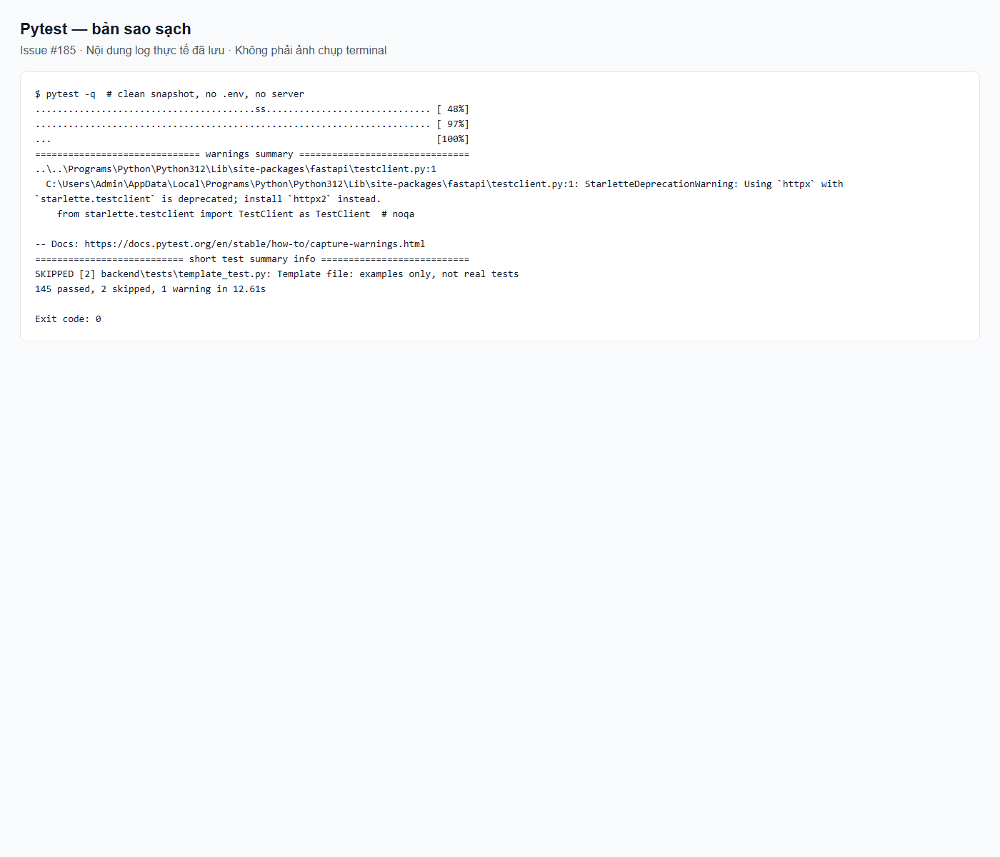
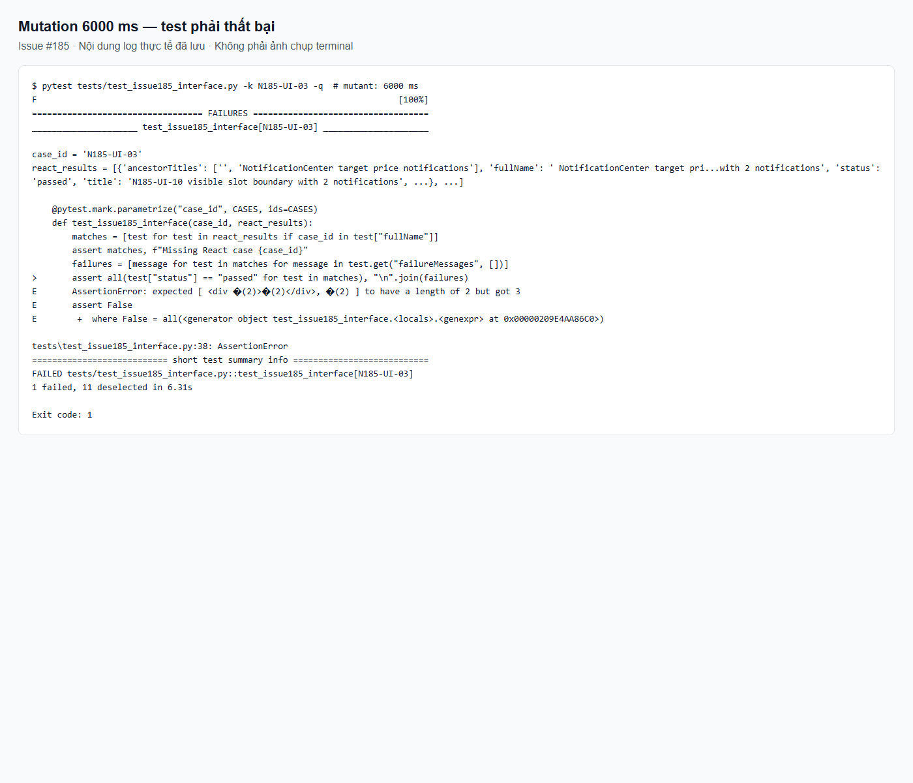

# Kiểm thử issue #185 — US02/P0

Tài liệu này bổ sung các yêu cầu thông báo của #185; giữ nguyên ma trận US01 trong [testing.md](../testing.md) và US02 trong [US02_TEST_CASES.md](../../backend/tests/US02_TEST_CASES.md).

## 1. What we test, and why

| Tầng | Kiểm thử và lý do |
|---|---|
| Services | Unit + fake database/SMTP: không gửi email khi lưu mục tiêu; chu kỳ đạt giá, chống lặp, tăng vượt, tái đạt. |
| Repository | SQL production trên SQLite trong bộ nhớ: giới hạn lịch sử, lọc tài khoản và lưu bền vững trạng thái đã xem. |
| Routes | FastAPI trong tiến trình, ASGITransport + dependency giả: xác thực, JSON, giới hạn ID; không chạy server. |
| Interface | React Testing Library/Vitest thật, Pytest đọc kết quả từng ID: hàng đợi, reload, lỗi/retry và đồng hồ giả. |

Ưu tiên kiểm tra mất thông báo khi reload, gửi email quá sớm và lộ lịch sử người khác. Giá, dữ liệu và đồng hồ đầu vào cố định, không phụ thuộc ngày chạy. Fixture offline chặn HTTP/Redis/PostgreSQL/SMTP thật cho các test #185.

## 2. Test cases for US02/P0

| ID | Story | Input | Expected result | Kind |
|---|---|---|---|---|
| N185-MAIL-01 / US02-TC-001 | US02/email | Đặt mới/đổi mục tiêu hợp lệ, email bật | Lưu thành công; không enqueue email | Normal, 2 biến thể |
| N185-MAIL-02 / US02-TC-002 | US02/email | Mục tiêu bằng giá hiện tại | 400 và rollback | Error/boundary |
| N185-MAIL-03 / US02-TC-003 | US02/email | Mục tiêu vượt giá hiện tại | 400 và rollback | Error/boundary |
| N185-MAIL-04 | US02/email | Trên ngưỡng → dưới → vẫn dưới → vượt → tái đạt | Chỉ gửi theo chuyển trạng thái | Normal/regression |
| N185-MAIL-05 | US02/email | 194999/195000/195001 và cờ đã gửi/chưa gửi | Reached chỉ ≤ ngưỡng; above chỉ > ngưỡng sau lần đạt | Boundary, 6 biến thể |
| N185-SEEN-01 | US02/đã xem | ID bản thân, người khác, không tồn tại; đọc lại dữ liệu | Chỉ đổi ID của mình; reload không nhận lại; lịch sử vẫn giữ; đánh dấu lại trả 0 | Normal/error isolation |
| N185-SEEN-02 | US02/đã xem | 0/199/200/201 ID | 422/200/200/422; không ghi khi lỗi | Boundary/error |
| N185-HIST-01 | US02/lịch sử | 0/9/10/11 mục và mục mới hơn của tài khoản khác | Trả 0/9/10/10 mục mới nhất của mình, gồm đã xem | Boundary/isolation |
| N185-HIST-02 | US02/lịch sử | Không có token gọi unseen/history/seen | Cả ba trả 401 | Error |
| N185-UI-01 | US02/toast | Giá chạm mục tiêu | Hiện giá và link; đánh dấu sau hiển thị | Normal |
| N185-UI-02 | US02/toast | Giá tăng vượt mục tiêu | Hiện đúng cảnh báo và giá | Normal |
| N185-UI-03 | US02/toast | 5 thông báo, polling trả lặp, các mốc 4999/5000/5001 ms | Không mất mục chờ; mỗi toast đủ 5 giây; không phát lại | Boundary/regression |
| N185-UI-04 | US02/reload | Đóng toast, unmount/remount | Lấp ô trống; chỉ mục chưa hiển thị nhận lại | Normal/reload |
| N185-UI-05 | US02/đã xem | Đánh dấu thất bại rồi thành công | Retry sau khi đóng, không hiện trùng | Error |
| N185-UI-06 | US02/thao tác | Toast xanh/đỏ, đồng hồ 4999/5000/5001 ms | Role status/alert, tiêu đề tiếng Việt và đóng ở 5 giây | Normal/error/boundary |
| N185-UI-07 | US02/thao tác | PUT thành công, DELETE lỗi, GET nền và POST seen | Toast tiếng Việt cho thao tác; không tạo toast nền | Normal/error |
| N185-UI-08 | US02/lịch sử | Một mục đã xem, một mục chưa xem | Hiện cả hai; chỉ đánh dấu mục chưa xem sau render | Normal |
| N185-UI-09 | US02/lịch sử | Tải lỗi rồi retry được danh sách trống | Hiện lỗi, cho tải lại, trạng thái trống | Error/empty |
| N185-UI-10 | US02/hàng đợi | 2/3/4 thông báo | Hiện 2/3/3; chỉ đánh dấu ID đã render | Boundary |
| N185-UI-11 | US02/hàng đợi | Poll chậm hơn 3 chu kỳ, unmount trước khi trả | Không chồng request hoặc đánh dấu dữ liệu đến muộn | Error/concurrency |
| N185-UI-12 | US02/lịch sử | Lỗi lưu trạng thái đã xem | Vẫn là Mới, không lặp request | Error |

Tên `test_us02_tc_*` giữ đúng main; comment N185-MAIL-01/02/03 truy vết cùng ca #185. Các ID Python khác dùng dấu gạch dưới. UI nằm trong `tests/test_issue185_interface.py`, gọi ba file React thật. Không bỏ qua khi thiếu thư viện hoặc test giao diện lỗi.

## 3. Automated tests

Thiết lập theo [SETUP.md](../SETUP.md), từ root chạy `pytest`; chỉ #185 dùng `pytest -m issue185 -q`. Không cần `.env`, server hoặc database thật. Với Docker, chạy backend và frontend riêng như hướng dẫn trong tài liệu setup vì container backend không chứa Node.js.

[Log bản sao sạch trước lần đồng bộ main này](evidence/issue185-green.txt), [log build](evidence/issue185-build.txt), [môi trường](evidence/environment.json). Đây là snapshot không có .env, frontend cài mới bằng npm ci; Python dùng dependencies đã cài, không phải máy hoặc venv mới hoàn toàn. Kết quả sau đồng bộ được lưu riêng ở `evidence/issue185-after-main.txt`.

Hai test template skip có chủ đích; sandbox Google OAuth thủ công không được thu thập. JSDOM không thay thế kiểm tra hình ảnh mọi trình duyệt, SMTP thật hoặc locking PostgreSQL.

## 4. What tests found

| Lỗi | Sửa | Test bảo vệ |
|---|---|---|
| Đánh dấu cả lô trước khi chỉ render 3 mục | Hàng đợi + đánh dấu sau render | UI-03/04/10, SEEN-01 |
| Email gửi ngay khi lưu mục tiêu | Bỏ enqueue khi lưu | MAIL-01, kể cả khi email bật |
| Test còn mong toast tồn tại sau đủ 5 giây | Kiểm tra 4999 ms còn, 5000/5001 ms đóng | UI-03/06 |
| Root pytest không tìm thấy app hoặc cần .env riêng | Cấu hình pytest root và môi trường test giả | Lần chạy tổng hợp |

[Mutation thực tế](evidence/issue185-red.txt): đổi 5000 thành 6000 ms trong bản sao tạm làm UI-03 đỏ; [khôi phục](evidence/issue185-restored.txt) xanh. Các ảnh là ảnh trình duyệt hiển thị log thật đã lưu, không phải ảnh terminal. Tạo lại bằng `scripts/verify_issue185_clean.py` rồi `scripts/capture_issue185_evidence.py`.

