# Milestone 3 - UI Document

```
Team:           Team 02 - Automated E-commerce Price Tracker
Topic:          A3
Members:        Nguyen Trong Dai (11247268), Mai Huy Dang (11247269)
                Pham Huu Gia An (11247254), Mai Tuan Manh (11247318),
                Le Ba Phong (11247339)
Product Owner:  @Dai-nguyen1506
Scrum Master:   @maimanhbel  (Sprint 3)

Repository:     https://github.com/SE-FDA-NEU/group2_ai66a_se.git;
Project board:  https://github.com/orgs/SE-FDA-NEU/projects/19/views/1;
Setup guide:    https://github.com/SE-FDA-NEU/group2_ai66a_se/blob/main/docs/SETUP.md
Pull Request:   https://github.com/SE-FDA-NEU/group2_ai66a_se/pull/160
Merge commit:   72634a7

Submitted by:   Nguyen Trong Dai
```

## Page 2 — Proof of Project Board

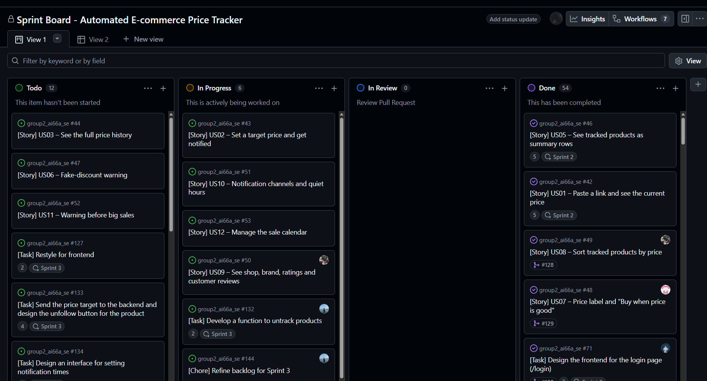

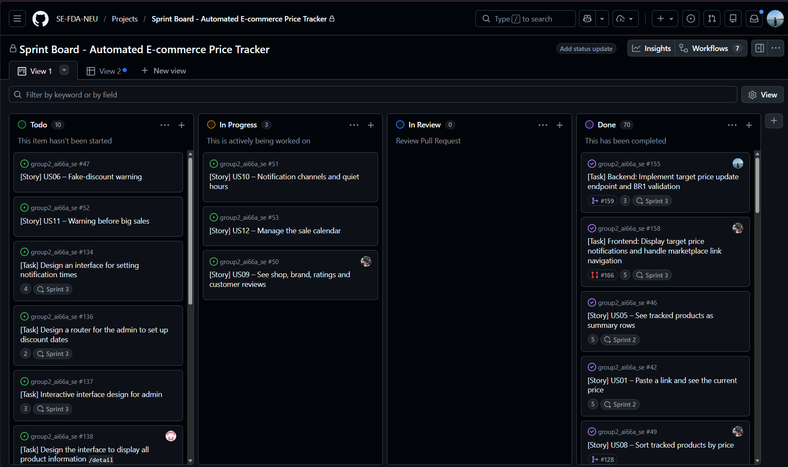

---

## Page 3 — Running App Screenshots (Visible Browser Address Bar)

### P0 Screen with Real Data (`/watchlist`)
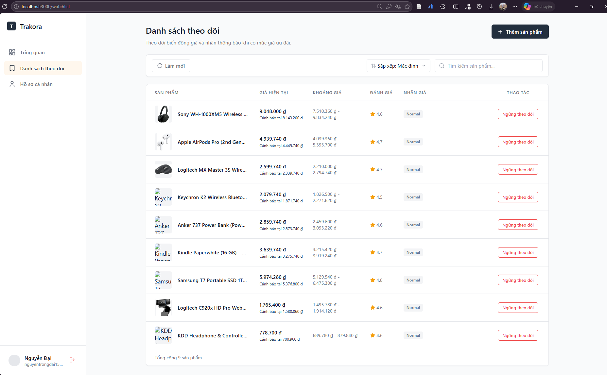

### Error Message Shown to User (`/detail/:productId` - BR1 Violation)
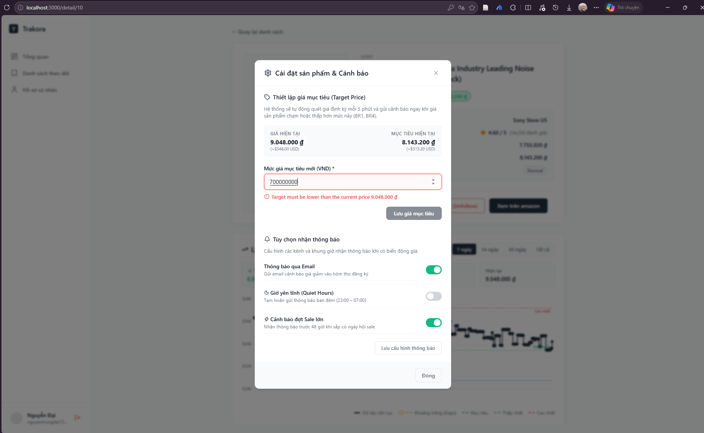

---

## 1. P0 stories and status

| Story | Screen(s) | Route | Status | Issue |
| ----- | --------- | ----- | ------ | ----- |
| **US01** – Paste a link and see the current price | Watchlist, Product Detail | `/watchlist`, `/detail/:productId` | works | #78, #80 |
| **US02** – Set a target price and get notified | Product Detail | `/detail/:productId` | works | #133, #155, #156, #161 |
| **US03** – See the full price history | Product Detail | `/detail/:productId` | works | #150, #154 |
| **US04** – Register and sign in with Google or Email | Landing, Login, Register, Forgot Password | `/`, `/login`, `/register`, `/forgot-password` | works | #45, #70, #73, #74, #127 |
| **US05** – See tracked products as summary rows | Watchlist | `/watchlist` | works | #84, #132, #148 |

---

### Updated screen flow diagram

Main path: `/` → `/login` (or `/register`) → `/watchlist` → `/detail/:productId`. A guest who opens `/watchlist`, `/detail/:productId`, or `/profile` directly is redirected to `/login`.

**How each screen is reached:**

| Screen | Reached from | Access |
| ------ | ------------ | :----: |
| `/` | Web Introduction (starting point) | G |
| `/register` | `/` (create account); `/login` ("Don't have an account?") | G |
| `/login` | `/` (sign in); `/register` (already have an account) | G |
| `/forgot-password` | `/login` ("Forgot password?") | G |
| `/watchlist` | `/login` or `/register` (signed in); `/detail` (back) | U |
| `/detail/:productId` | `/watchlist` (click on a product card); integrates target price & notification settings modal (`ProductSettingsModal`) | U |
| `/profile` | `/watchlist` (account menu); anywhere signed in | U |

**Flow diagram:**

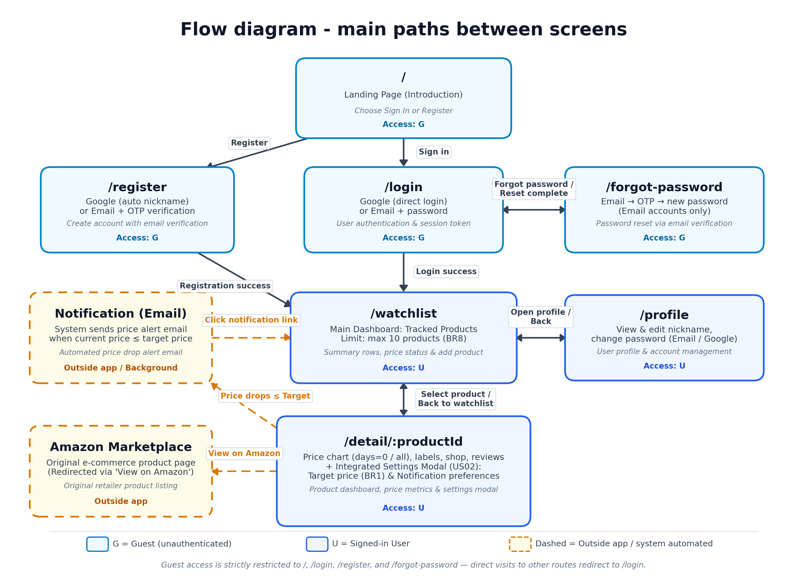

**Screen Access Control:**
- **G (Guest):** Can only access `/`, `/login`, `/register`, and `/forgot-password`. Direct attempts to access other routes automatically redirect to `/login`.
- **U (Signed-in User):** Access to `/watchlist`, `/detail/:productId`, and `/profile`. On `/detail/:productId`, users can open the Settings modal to update their target price and configure notification preferences (Email, Web Push, Quiet Hours). When an authenticated user navigates to `/`, they are automatically redirected to `/watchlist`.

---

## 2. Wireframes

All screens serving P0 User Stories (US01 – US05) are detailed below. Specifically, the core screen `/watchlist` is fully illustrated across **4 states (Empty · Loading · Error · Data)** in strict adherence to M3 standards.

---

### 2.1 `/` — Landing Page

"The user comes here to see what Trakora is and sign in to start tracking prices."

**API Endpoints called:** None (Static landing/introduction page; navigation to authentication via `/login` and `/register`).

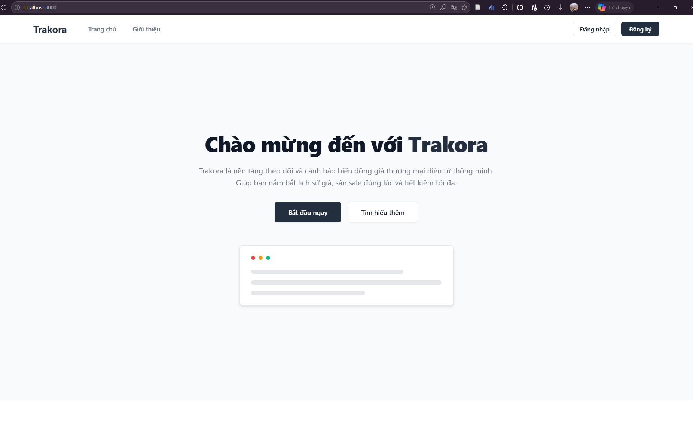

---

### 2.2 `/register` — Register Page

"The user comes here to create a new account using Google or Email (with OTP verification)."

**API Endpoints called:**
- `POST /api/v1/otp/send` (send 6-digit OTP verification code via email, reason: `verify-email`)
- `POST /api/v1/otp/verify` (verify OTP code, returns `verified_token`)
- `POST /api/v1/auth/register` (complete account creation with `verified_token`)
- `POST /api/v1/auth/google` (quick registration/sign-in via Google ID token)

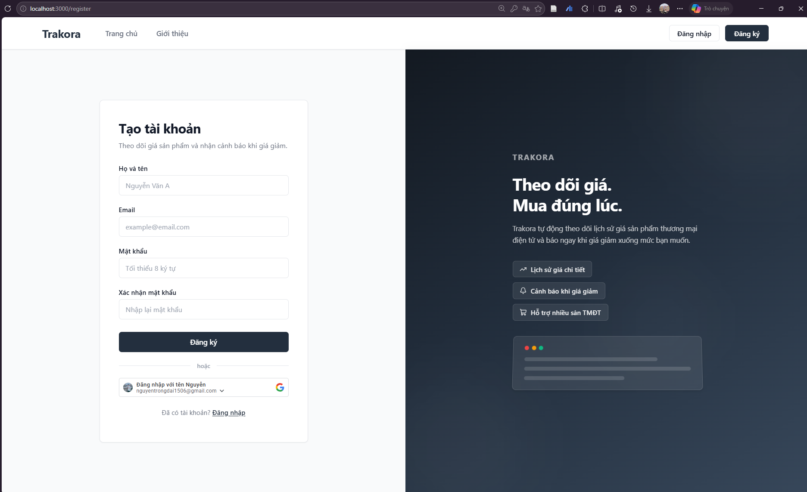

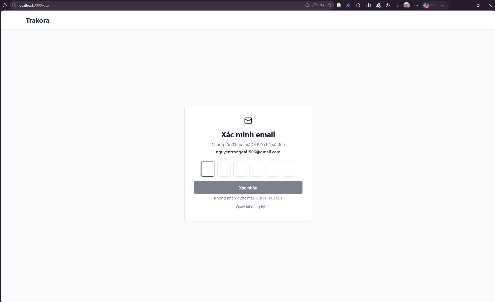

---

### 2.3 `/login` — Login Page

"The user comes here to sign in to their existing account."

**API Endpoints called:**
- `POST /api/v1/auth/login` (submit credentials: `username`, `password`, receive JWT `access_token`)
- `POST /api/v1/auth/google` (authenticate Google OAuth credential)
- `GET /api/v1/user/me` (retrieve user profile after sign-in)

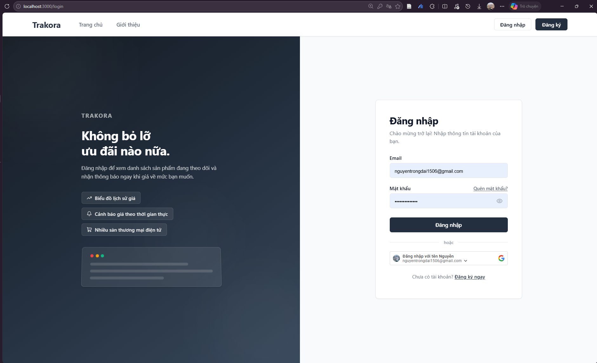

---

### 2.4 `/forgot-password` — Forgot Password Page

"The user comes here to reset their password using email OTP verification."

**API Endpoints called:**
- `POST /api/v1/otp/send` (send password reset OTP, reason: `reset-password`)
- `POST /api/v1/otp/verify` (verify password reset OTP)
- `POST /api/v1/auth/reset-password` (set new password)

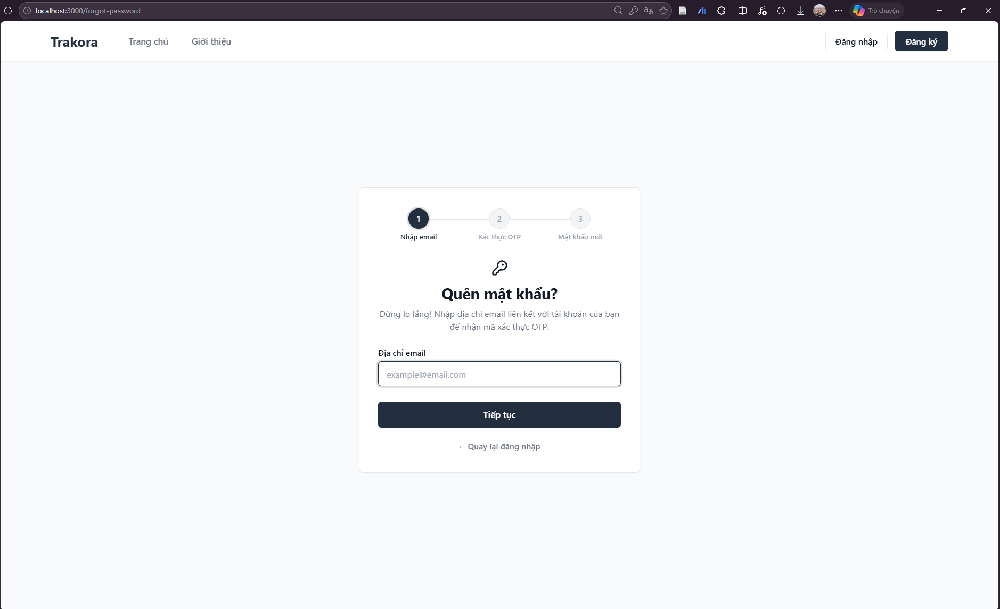

---

### 2.5 `/watchlist` — Watchlist Page (Drawn in 4 States)

"The user comes here to see all tracked products at a glance and add new ones."

**API Endpoints called:**
- `GET /api/v1/watchlist` (retrieve tracked product list, price labels, price range, review score)
- `POST /api/v1/watchlist` (add new product tracking link, enforces 10-product limit - BR8)
- `DELETE /api/v1/watchlist/{product_id}` (stop tracking product, triggers 7-day retention grace period - BR15)
- `GET /api/v1/watchlist/notifications` (poll for price drop alerts)

#### Four UI States (4 States Wireframe / Screenshots):

| 1. Empty State (`/watchlist` empty) | 2. Loading State (`/watchlist` loading) |
|:---:|:---:|
| 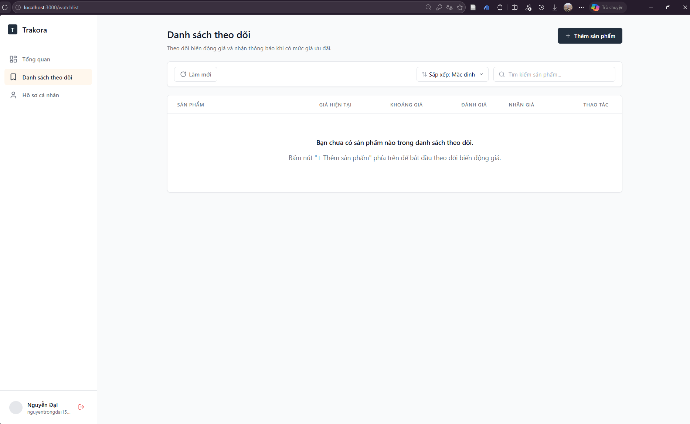 | 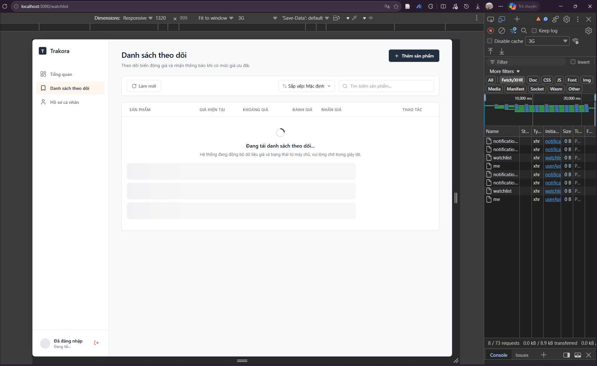 |

| 3. Data State (`/watchlist` with real data) | 4. Error State (10-product limit reached - BR8) |
|:---:|:---:|
|  | 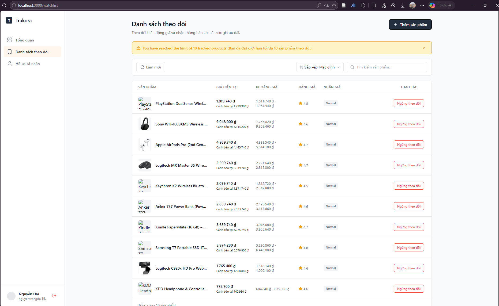 |

---

### 2.6 `/detail/:productId` — Product Detail & Price Dashboard

"The user comes here to see everything about one tracked product: price chart, labels, target price, shop info, reviews."

**API Endpoints called:**
- `GET /api/v1/watchlist` (fetch product summary data)
- `GET /api/v1/watchlist/{product_id}/history` (fetch complete price history and time gaps)
- `PUT /api/v1/watchlist/{product_id}/target-price` (update or set target price via Settings modal)
- `DELETE /api/v1/watchlist/{product_id}` (stop tracking product)
- `GET /api/v1/watchlist/{product_id}/stream` (Server-Sent Events connection for real-time price updates)

**Integrated Settings Modal (`ProductSettingsModal`):**
- Clicking the **"Settings"** button on `/detail/:productId` opens a modal offering:
  1. **Adjust Target Price (Target Price — P0 / US02):** Enables users to update their desired buying price (strictly enforcing $Target < CurrentPrice$ under BR1), immediately rendering a dashed blue reference line on the price chart.
  2. **Configure Notification Preferences (Notification Preferences — Preparation for US10):** Allows toggling notifications via Email and Web Push, along with configuring Quiet Hours (suppressing overnight notifications).

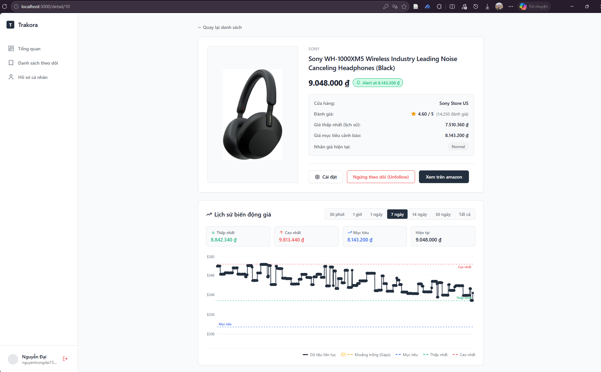

---

## 3. Error messages

The system strictly adheres to user-friendly error design principles: **clearly state what happened**, **the cause**, and **the actionable next step for the user**. Technical error codes such as "Error 422", "Error 500", or raw stack traces are never exposed to users on the UI. The reconciliation table below demonstrates the exact literal strings that users see on the frontend interface alongside corresponding backend error details:

| API error code | HTTP | Business rule | The exact message the user sees |
| -------------- | :--: | ------------- | -------------------------------- |
| `INVALID_TARGET_PRICE` | 400 | **BR1** — Target must be lower than current price | **Settings Modal (`ProductSettingsModal`):** `Target must be lower than the current price {current_price}` *(e.g., "Target must be lower than the current price 9.048.000 đ")*<br>**Add Product Modal (`AddProductModal`):** `Target must be lower than the current price {vnd} ₫ ({rawPrice} {cur}). Vui lòng nhập mức giá nhỏ hơn.`<br>*(Backend returns: "Target must be lower than the current price." or with current price)* |
| `WATCHLIST_LIMIT_REACHED` | 400 | **BR8** — Maximum 10 tracked products per user | **UI Banner (`WatchlistPage`):** `You have reached the limit of 10 tracked products (Bạn đã đạt giới hạn tối đa 10 sản phẩm theo dõi).`<br>*(Backend API returns: "You can track at most 10 products.")* |
| `INVALID_PRODUCT_LINK` | 400 | **BR9** — Valid product link with product ID | `A supported product link with a product ID is required.` *(UI displays: "Lỗi: A supported product link with a product ID is required.")* |
| `INVALID_AMAZON_LINK` | 400 | **BR9** — Valid Amazon product link format | `A valid Amazon product link is required` *(UI displays: "Lỗi: A valid Amazon product link is required")* |
| `AMAZON_ONLY` | 400 | **BR9** — Supported marketplace (Sprint 2 & 3: Amazon only) | `Amazon only` *(UI displays: "Lỗi: Amazon only")* |
| `MULTIPLE_LINKS` | 400 | **BR9** — Single link per submission | `Paste one link at a time` *(UI displays: "Lỗi: Paste one link at a time")* |
| `OTP_INVALID` | 400 | **BR13** — 6-digit OTP, max 5 attempts | **Attempts 1–4:** `Mã OTP không chính xác. Bạn còn {N} lần thử.` *(e.g., "Mã OTP không chính xác. Bạn còn 4 lần thử.")*<br>**Attempt 5:** `Mã OTP không chính xác. Bạn đã hết 5 lần thử. Vui lòng nhấn 'Gửi lại mã' để nhận mã mới.` |
| `OTP_EXPIRED` | 400 | **BR13** — OTP expires after 5 minutes | `Mã OTP đã hết hạn hoặc không tồn tại.` |
| `OTP_LIMIT_EXCEEDED` | 400 | **BR13** — OTP locked after 5 failed attempts | `Bạn đã nhập sai mã OTP quá 5 lần. Mã hiện tại đã bị hủy để đảm bảo an toàn. Vui lòng yêu cầu mã mới.` *(Triggered when user attempts verification after reaching 5 failures)* |
| `EMAIL_ALREADY_EXISTS` | 400 | User registration constraint | **Backend:** `Email này đã tồn tại.`<br>**Registration Form UI:** `Email này đã được đăng ký. Vui lòng đăng nhập.` |
| `INVALID_LOGIN` | 401 | User authentication | `Email hoặc mật khẩu không chính xác.` |
| `GOOGLE_ACCOUNT_NO_PASSWORD`| 400 | Google OAuth password reset prevention | **UI (`ForgotPasswordPage`):** `Tài khoản này được đăng ký bằng Google và không có mật khẩu ứng dụng. Vui lòng đăng nhập trực tiếp bằng Google.`<br>*(Backend returns: "Tài khoản này được đăng ký bằng Google và không có mật khẩu ứng dụng để đặt lại.")* |
| `PRODUCT_ALREADY_TRACKED`| 409 | Duplicate tracking prevention | `This product is already in your watchlist.` *(UI displays: "Lỗi: This product is already in your watchlist.")* |
| `TRACKING_NOT_FOUND` | 404 | Accessing tracked product | `Sản phẩm không nằm trong danh sách theo dõi của người dùng này.` |
| `MARKETPLACE_UNAVAILABLE`| 503 | External marketplace integration (RapidAPI) | `Marketplace lookup is not configured.` *(UI displays: "Lỗi: Marketplace lookup is not configured.")* |
| `MARKETPLACE_UPSTREAM_ERROR`| 502| Upstream marketplace server error | `Marketplace could not return product information.` *(UI displays: "Lỗi: Marketplace could not return product information.")* |

---

### Specific Error Message Worked Examples

#### Case 1 — Violation of Business Rule BR1 (Setting target price $\ge$ current price):
- **Context:** Sony WH-1000XM5 headphones on `/detail/10` currently has a price of `9.048.000 đ (~$348.00 USD)`. The user opens the Settings modal (`ProductSettingsModal`) and inputs a target price of `70.000.000 đ` (higher than the current price).
- **UI Behavior:** 
  - As soon as the user enters the value or clicks "Save Target Price" (Lưu giá mục tiêu), a prominent red-bordered error message appears directly below the input field:
    `"Target must be lower than the current price 9.048.000 đ"`.
  - The "Save Target Price" button is automatically disabled until a valid price lower than current price is entered.


#### Case 2 — Violation of Business Rule BR8 (Reaching the maximum 10 tracked products limit):
- **Context:** The user already tracks 10 products on `/watchlist` and clicks the `+ Thêm sản phẩm` (Add product) button.
- **UI Behavior:**
  - The link submission modal is completely prevented from opening.
  - A yellow-orange warning banner appears above the product table:
    `"You have reached the limit of 10 tracked products (Bạn đã đạt giới hạn tối đa 10 sản phẩm theo dõi)."`.


#### Case 3 — Violation of Business Rule BR13 (Incorrect OTP during registration):
- **Context:** The user registers via email, receives a 6-digit OTP verification code, but mistypes digits.
- **UI Behavior:**
  - Below the OTP input cells, a red warning text clearly informs the user of remaining attempts:
    `"Mã OTP không chính xác. Bạn còn 4 lần thử."` (after the first failed attempt).
  - On the 5th failed attempt:
    `"Mã OTP không chính xác. Bạn đã hết 5 lần thử. Vui lòng nhấn 'Gửi lại mã' để nhận mã mới."`.
  - If the user attempts to verify again after exceeding 5 attempts:
    `"Bạn đã nhập sai mã OTP quá 5 lần. Mã hiện tại đã bị hủy để đảm bảo an toàn. Vui lòng yêu cầu mã mới."` and the inputs are locked.

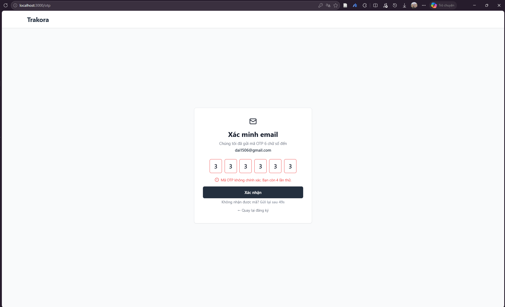

#### Case 4 — Violation of Business Rule BR9 (Pasting a non-Amazon product link):
- **Context:** The user opens the Add Product modal on `/watchlist` and pastes a link from an unsupported platform (e.g., TikTok video: `https://www.tiktok.com/@king.mayo683/video/7397734135547432223`).
- **UI Behavior:**
  - The modal displays a red alert box containing:
    `"Lỗi: Amazon only"`.
  - Backend error code triggered: `AMAZON_ONLY` (HTTP 400).

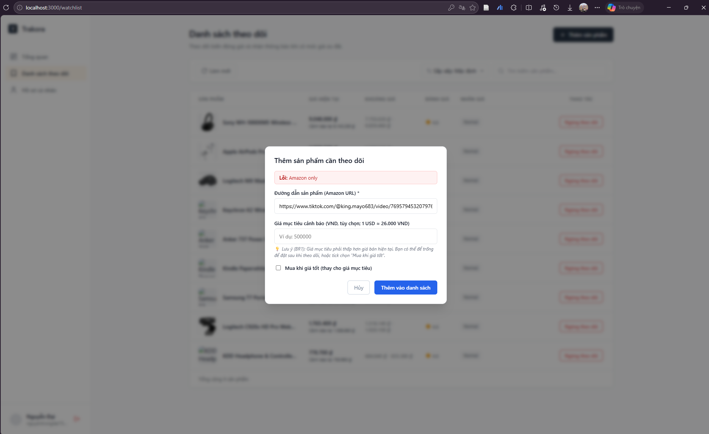

---

## 4. What changed since M2

During the implementation and refinement of the user interface (UI) in Sprint 3, several adjustments and additions were introduced relative to the Milestone 2 architecture design document (`docs/design.md`):

### Change 1: Added Settings Modal on `/detail` and Target Price Dashed Line on Chart (US02)

| Aspect | Change Details |
|---|---|
| **M2 Design** | In M2, `target_price` was only provided once during product creation via `POST /api/v1/watchlist`. The product detail screen lacked an interactive UI mechanism for users to readjust their target price after observing historical price fluctuations. |
| **Post-UI Design** | 1. Added a **Settings** button (gear icon ⚙️) on `/detail` that triggers a pop-up modal (`ProductSettingsModal`), allowing users to update their target price at any time via `PUT /api/v1/watchlist/{product_id}/target-price`.<br>2. Added a **blue dashed horizontal reference line** displaying the target price threshold directly on the Recharts price chart, alongside existing dashed lines for Highest and Lowest price.<br>3. Added the "Target" (Mục tiêu) metric to the statistics summary grid (`statsGrid`) and chart legend (`chartLegend`). |
| **Rationale** | When reviewing actual price history trends, users frequently reassess and adjust their target purchase threshold. Visualizing the target price as a dashed line directly on the chart enables intuitive comparison of the gap between current price and expected purchase price. |
| **Code Impact** | Updated frontend `PriceHistoryChart.tsx` (added `targetPrice` prop, calculated `effectiveMin`/`effectiveMax` for Y-axis, rendered `ReferenceLine`), `ProductDetailPage.tsx`, and `ProductSettingsModal.tsx`. |

---

### Change 2: Extended Price History Parameter to Support "All Time" (`days=0`) (US03)

| Aspect | Change Details |
|---|---|
| **M2 Design** | Endpoint `GET /api/v1/watchlist/{product_id}/history` constrained the `days` parameter with `Query(ge=1, le=365)`. The UI only provided 3 static filter buttons: 7 days, 14 days, and 30 days. |
| **Post-UI Design** | Backend relaxed the validator constraint to `ge=0`, designating `days=0` as a special value representing the complete price history (All time) since the product was first tracked. The chart UI added an **"All"** (Tất cả) time-range button alongside short-term options. |
| **Rationale** | Strictly satisfies the acceptance criteria of User Story US03: *"covering however long the product has been tracked"* — users have the right to view the entire price history of a product from the moment it was tracked in the system. |
| **Code Impact** | Backend validator updated in `watchlist_router.py`. Frontend added `all` option to `RANGE_OPTIONS` in `PriceHistoryChart.tsx`. |

---

### Change 3: Blocked Forgot Password Flow for Google OAuth-Only Accounts (US04)

| Aspect | Change Details |
|---|---|
| **M2 Design** | The password reset OTP endpoint `POST /api/v1/otp/send` only checked whether the email existed, without validating the account's authentication method (`auth_provider`). |
| **Post-UI Design** | When a user submits an email belonging to a Google-only account on `/forgot-password`, the backend detects `auth_provider == 'google'` and returns error code `GOOGLE_ACCOUNT_NO_PASSWORD`. The UI displays guidance prompting the user to click the "Sign in with Google" button instead. |
| **Rationale** | Google accounts do not store a `password_hashed` in the database. Permitting users to request an OTP for password reset leads to an unrecoverable error state when attempting to complete the reset step. |
| **Code Impact** | Added `GOOGLE_ACCOUNT_NO_PASSWORD` error code to `backend/app/schemas/user_schema.py` and handled UI rendering in `ForgotPasswordPage.tsx`. |

---

### Change 4: Standardized Profile Route from `/settings` to `/profile` (US04, BR14)

| Aspect | Change Details |
|---|---|
| **M2 Design** | In initial frontend code, the nickname and password management view was mounted under route `/settings`. |
| **Post-UI Design** | Formally migrated to route `/profile` to achieve 100% consistency with the screen specification table in `docs/requirements.md`. Simultaneously retained backward-compatible automatic redirection (`Navigate to="/profile"`) from `/settings`. |
| **Rationale** | Ensures complete consistency across business requirements, design documentation, and actual codebase. |
| **Code Impact** | Updated route configuration in `App.tsx` and sidebar link in `Sidebar.tsx`. |
